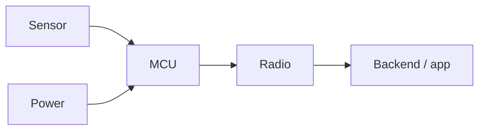

# Architecture: <Project name>

- **Updated:** YYYY-MM-DD

## Overview
What the system does, in one paragraph.

## Block diagram

## Subsystems
| Subsystem | Responsibility | Key parts | Interfaces |
|---|---|---|---|
| Power | | | |
| Compute | | | |
| Sensing | | | |
| Actuation | | | |
| Comms | | | |
| Software / backend | | | |

## Power budget
| Load | Voltage | Active mA | Sleep mA | Duty cycle | Avg mA |
|---|---|---|---|---|---|

## Data flow and protocols
Topics, message formats, rates.

## Failure handling
Watchdogs, brownout, comms loss, failsafes.

## Open questions
